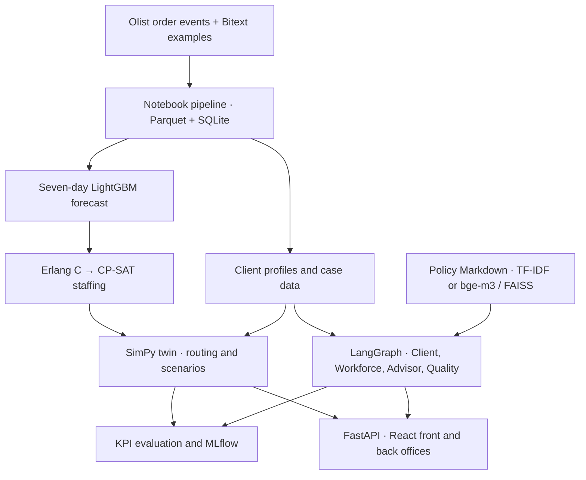

# CallVerse

CallVerse is a **multi-agent digital twin of an e-commerce customer-service center**. It forecasts contact volume by intent, builds staffing plans, and replays a week in a discrete-event simulator so managers can compare decisions before applying them. Its customer portal and advisor desk demonstrate policy-grounded support, tool calls, and conversation scoring.

**Advanced Data Science Project · ESPRIT**

> The project uses real Olist order events and Bitext example utterances. Contacts, tickets, chats, satisfaction scores, and much of the simulated operating behavior are generated. Use the results as prototype evidence and recalibrate on real contact-center logs before making operational decisions.

## Contents

- [What the application does](#what-the-application-does)
- [Quick start](#quick-start)
- [Prepare the datasets](#prepare-the-datasets)
- [Run the demo](#run-the-demo)
- [Configure the models](#configure-the-models)
- [Deploy with Docker Compose](#deploy-with-docker-compose)
- [Reproduce the experiments](#reproduce-the-experiments)
- [Results and limitations](#results-and-limitations)
- [Architecture and repository layout](#architecture-and-repository-layout)
- [API, WebSocket, and MCP](#api-websocket-and-mcp)
- [Development checks](#development-checks)
- [Troubleshooting](#troubleshooting)
- [Data use and documentation](#data-use-and-documentation)

## What the application does

| User | Workflow |
| --- | --- |
| Workforce planner | Inspect a seven-day demand forecast, produce a staffing plan, then compare scenarios and routing policies in the twin. |
| Manager | Replay simulated arrivals and queues on the live floor. Compare prepared and unprepared plans and inspect service, abandonment, and costs. |
| Customer | Search help articles, inspect a demo order, create a new demo profile, and chat or use the browser voice interface. |
| Advisor | Open a case in the desk, review order context and evidence, draft or send a reply, and inspect the resulting conversation review. |
| Quality reviewer | Label a historical conversation and compare the rubric scores with the automated reviewer. |

| Objective | Implementation | Main measures |
| --- | --- | --- |
| BO1 / DSO1 · Shorter queues | FIFO baseline, tuned skill scoring, MaskablePPO research policy | ASA, p90 wait, abandonment, service level |
| BO2 / DSO2 · Correct support | Policy-backed RAG, approved templates, case tools, checklist and LLM review | Recall@4, verified actions, simulated CSAT, judge agreement |
| BO3 / DSO3 · Lower staffing cost at target service | Erlang C requirements, OR-Tools CP-SAT, fixed and rule-based comparisons | Labor cost, cost per handled contact, SLA, roster constraints |
| BO4 / DSO4 · Peak readiness | Global LightGBM contact forecast and SimPy what-if scenarios | wMAPE, fidelity checks, service and cost differences |

## Quick start

### Prerequisites

- Git, Python **3.11 or 3.12**, Node.js **20** and npm. The GitHub Actions workflow uses Python 3.11 and Node 20.
- Source datasets for a first data build. The Git checkout contains the code, notebooks and policy documents.
- Optional Docker Engine and Compose v2, or Docker Desktop. Optional NVIDIA CUDA setup for local model inference.

Clone the project and create a Python environment.

```bash
git clone https://github.com/hamzafarha/CallVerse.git
cd CallVerse
python -m venv .venv
```

Activate it on macOS or Linux.

```bash
source .venv/bin/activate
cp .env.example .env
```

Activate it in Windows PowerShell.

```powershell
.\.venv\Scripts\Activate.ps1
Copy-Item .env.example .env
```

Install the project in the activated environment.

```bash
python -m pip install --upgrade pip
python -m pip install -e ".[all]"
callverse --help
callverse status
```

On Linux/Windows, to select CPU-only PyTorch explicitly, install it **before** `.[all]`.

```bash
python -m pip install torch --index-url https://download.pytorch.org/whl/cpu
```

On macOS use the regular PyTorch dependency resolution. For NVIDIA local inference, the repository's GPU target uses the PyTorch `cu126` index and needs a compatible driver. See [Configure the models](#configure-the-models).

For a deterministic first run, set these values in the root `.env`.

```dotenv
CALLVERSE_LLM_MODE=off
CALLVERSE_RETRIEVER=keyword
HF_HUB_OFFLINE=1
```

These settings use approved templates and checklist review and avoid LLM calls. Follow the data setup below before using data-backed screens. Run Python commands from the repository root and npm commands from `frontend/`.

## Prepare the datasets

Download the [Olist Brazilian E-commerce dataset](https://www.kaggle.com/datasets/olistbr/brazilian-ecommerce) and the [Bitext retail e-commerce dataset](https://huggingface.co/datasets/bitext/Bitext-retail-ecommerce-llm-chatbot-training-dataset). The pipeline checks the following exact paths. Keeping the additional Olist geolocation CSV from the archive is fine.

```text
data/raw/
  olist/
    olist_orders_dataset.csv
    olist_order_items_dataset.csv
    olist_customers_dataset.csv
    olist_order_payments_dataset.csv
    olist_order_reviews_dataset.csv
    olist_products_dataset.csv
    olist_sellers_dataset.csv
    product_category_name_translation.csv
  bitext/
    bitext-retail-ecommerce-llm-chatbot-training-dataset.csv
```

Build the core data and a lightweight forecast.

```bash
callverse data --no-knowledge-base
callverse forecast --fast
callverse validate
```

The data command runs notebooks 03–08 with the `python3` Jupyter kernel, builds the tickets and SQLite database, and checks the processed tables. If the kernel points outside the active environment, register it there with `python -m ipykernel install --sys-prefix --name python3`. The forecast command generates the out-of-sample predictions used by the scenario planner. The fast mode omits SARIMA and Prophet.

With an existing compatible `data/processed/` and `data/callverse.db`, run `callverse validate` and generate the forecast if it is missing. Keep the Bitext CSV available when rebuilding the intent classifier. The classifier is built on first use if its artifact is absent. To add semantic search, follow the embedding instructions below.

## Run the demo

Install the front-end dependencies once.

```bash
cd frontend
npm ci
```

On Linux, a clean install can miss the platform-specific Rollup binary. See the [workaround below](#linux-rollup-binary).

Start the API and two apps in separate terminals.

| Terminal | Working directory | Command | Open |
| --- | --- | --- | --- |
| API | Repository root, venv active | `callverse serve` | [Swagger](http://127.0.0.1:8000/docs) · [Health](http://127.0.0.1:8000/api/health) |
| Front office | `frontend/` | `npm run dev:front` | [Customer and advisor app](http://localhost:5173) |
| Back office | `frontend/` | `npm run dev:back` | [Manager app](http://localhost:5174) |

1. **Back office** → Digital twin. Choose **Delivery delays** and compare the unprepared and prepared plans with the same router and seed. Read abandonment, service level, and labor cost alongside the floor replay. **Black Friday aftermath** replays a week of generated support demand tied to historical Olist order events.
2. **Front office** → choose a demo customer and ask about an order. Follow order verification, policy evidence and the recommended action. The advisor desk shows the corresponding human/copilot workflow.
3. **Back office** → Quality and Evaluation. Inspect the rubric and calibration source. Generate the evaluation artifacts before presenting the full scorecard.

For a phone on the same Wi-Fi, run `callverse phone-cert` from the root, keep the API running, and start `npm run dev:phone` from `frontend/` in place of `dev:front`. Open the printed HTTPS `/phone` address on the phone. The browser must support speech recognition and have microphone permission. Use the self-signed certificate on a trusted demo network. These calls use the browser and the application session.

## Configure the models

| Mode | Root `.env` settings | Behavior |
| --- | --- | --- |
| Hosted, repository default | `CALLVERSE_LLM_PROVIDER=openrouter`, `CALLVERSE_LLM_MODE=auto`, valid `OPENROUTER_API_KEY` | Tries hosted models first. Automatic flows can fall back to local models or templates and rules. |
| Local model inference | `CALLVERSE_LLM_PROVIDER=transformers`, `CALLVERSE_LLM_MODE=auto`, `CALLVERSE_LLM_PROFILE=gpu4gb` or `full` | Downloads are prepared separately. The 4-bit profile uses SmolLM3 for Advisor and Client and Granite 4.0 for Quality. |
| Deterministic | `CALLVERSE_LLM_MODE=off`, `CALLVERSE_RETRIEVER=keyword` | Disables LLM inference and uses TF-IDF keyword retrieval, approved replies and checklist review. |

[configs/agents.yaml](configs/agents.yaml) defines hosted model IDs and fallbacks per role. The primary hosted roles use NVIDIA Nemotron for Advisor/Client and Xing 4.0 for Quality. Provider availability and outputs can vary. Hosted mode can send prompts and case context to the provider. Use synthetic demo cases and keep the key in `.env`.

Download the models for the active local profile.

```bash
callverse llm-pull
callverse status
```

`llm-pull` downloads role weights and records resolved revisions in `artifacts/traces/llm_models.lock.json`. Keep the lock with the experiment evidence. To build semantic retrieval independently, temporarily set `HF_HUB_OFFLINE=0` in `.env`, then build the index.

```bash
python scripts/build_knowledge_base.py
```

After the embedding model is cached, set `HF_HUB_OFFLINE=1` and `CALLVERSE_RETRIEVER=auto`. The `embedding` setting explicitly requires the index and model, which is useful when verifying dense-retrieval results. The `auto` setting falls back to keyword search if dense retrieval cannot load.

## Deploy with Docker Compose

Copy `.env.example` to `.env` as shown above. Build the data and forecast first using the host instructions, or mount the raw CSVs and run the pipeline inside the API container.

```bash
docker compose up --build -d
docker compose ps
```

| Service | URL |
| --- | --- |
| Front office, nginx | [localhost:8080](http://localhost:8080) |
| Back office, nginx | [localhost:8081](http://localhost:8081) |
| FastAPI / Swagger | [localhost:8000/docs](http://localhost:8000/docs) |
| MLflow UI | [localhost:5000](http://localhost:5000) |

Compose runs FastAPI, nginx, MLflow and its PostgreSQL database. The API mounts the host's `data/`, `artifacts/`, and `configs/`. Named volumes persist model cache and MLflow state. The current lockfile can also miss the native Rollup binary needed by the Alpine web image. If the web build fails on that package, repair the platform entries in the lockfile and rerun the build, or use the host demo path. If the raw inputs are present on the host, a CPU demo dataset can be built inside the container.

```bash
docker compose exec api callverse data --no-knowledge-base
docker compose exec api callverse forecast --fast
docker compose restart api
```

Use the GPU override on an NVIDIA host with the NVIDIA Container Toolkit.

```bash
docker compose -f docker-compose.yml -f docker-compose.gpu.yml up --build -d
docker compose exec api callverse llm-pull
```

This is a local demo deployment. Keep it on a trusted machine/network. The sample Compose password is for local use. A hosted deployment needs TLS, application authentication, role-based access and protected storage.

## Reproduce the experiments

Run the full pipeline from the root with raw data available. To evaluate dense retrieval, prepare the bge-m3 cache and index and verify the active retriever.

```bash
callverse all
```

| Stage | Command | Expected evidence |
| --- | --- | --- |
| Data | `callverse data` then `callverse validate` | Executed notebooks in `artifacts/notebook_runs/`, Parquet tables, SQLite, data contracts and optional FAISS index |
| Forecast | `callverse forecast` | `artifacts/forecasts/contact_forecast_backtest_{predictions.parquet,metrics.csv}`, feature importance, LightGBM model and next-week forecast |
| Routing | `callverse train-rl` | `artifacts/policies/routing_maskable_ppo.zip`, skill-score weights and `artifacts/evaluations/routing_comparison*.csv` |
| Twin fidelity | `callverse fidelity` | `twin_fidelity_*.csv` in the evaluation folder |
| Full evaluation | `callverse evaluate --seeds 10 --conversations 40` | Scenario, planner and router CSVs, BO2 template batch, retrieval and calibration tables, `component_metrics.csv`, `scorecard.json` |
| Advisor variants | `callverse agents --n 12 --variants template,rag_policy,rag` | `dso2_agents_*.csv`, with results for the currently active backend |
| LLM judge | `callverse judge-calibrate --judge llm` | `dso2_judge_calibration_*.csv`, with label source and agreement |

`callverse all --skip-data` reuses prepared tables. `callverse all --quick --skip-data` shortens the forecast comparison and uses 50,000 PPO decisions and five evaluation seeds. On a fresh checkout, use `callverse data` to prepare the data first. The default all/evaluate commands benchmark template conversations and rules calibration. Run LLM comparisons explicitly with a working backend, record provider/model identity and preserve a separate output directory when comparing runs. LLM variant files merge by variant, so re-running one variant can leave other rows from a previous run.

Run individual experiments to inspect their outputs.

```bash
callverse schedule --scenario promo_spike --planner cpsat
callverse simulate --scenario delivery_delays --planner cpsat --router fifo --seeds 10 --unprepared
callverse simulate --scenario delivery_delays --planner cpsat --router fifo --seeds 10
callverse chat --mode template
callverse chat --mode llm --variant rag_policy
```

Each scenario changes a dated week. Use the same scenario and seed set across options. The evaluator pairs runs by seed and uses 95% Student-t confidence intervals for differences. The backtest uses weekly chronological cutoffs and a seven-day forecast horizon. Save the Git revision, data versions or checksums, environment versions, configs, seeds, model lock, outputs, and label source with each reported run. MLflow can read the local store with `mlflow ui --backend-store-uri sqlite:///mlflow.db --port 5000`.

## Results and limitations

These are historical project results from the [validation report](docs/IP_VALIDATION_REPORT.md) and [knowledge-base study](docs/knowledge_base_report.md). The repository excludes the generated run directories.

| Area | Reported result | Interpretation |
| --- | --- | --- |
| Forecast | Total wMAPE **25.3%** for LightGBM vs **31.6%** seasonal naïve over 46 weekly origins | Aggregate error fell 6.3 percentage points. Classical models won on some smaller groups. |
| Twin fidelity | Waiting probability **0.279** vs **0.285** for Erlang C, with hourly TVD **0.015** against the input profile | Checks engine behavior and consistency with generated inputs. |
| Preparedness | Understaffed hours **60–84%** lower and abandonment **55–76%** lower across three modeled shocks | The modeled staff-shortage response cost more overall at the assumed abandonment cost. |
| Shift planning | **€7,050** vs **€11,760** for the peak-sized fixed baseline, with **92.4%** vs **97.7%** answered in 20 s | CP-SAT clears the 80% target. A tuned fixed plan cost **€7,056** in the normal week. |
| Routing | PPO answered live contacts in **21.7 s** on average vs **25.2 s** FIFO on unseen stressed days | Skill scoring reduced abandonment more consistently in the peak-week study. CLI and API simulation requests default to FIFO. |
| Retrieval | Dense recall@4 **96.9%** vs **80.4%** for TF-IDF over 255 queries | Retrieval measures evidence coverage. |
| Advisor | Hybrid policy action verified on **12/12** sampled cases and simulated CSAT **4.33/5** | Small paired study on an earlier Qwen/Llama configuration. The current hosted models need a new evaluation. |
| Judge | Historical proxy-label resolution κ **0.06** for the LLM judge and **0.39** for the checklist | Both fall below the **0.40** trust threshold. Human-labeled cases are required for real calibration. |

The **Black Friday aftermath** comparison and the newer `agentic` advisor are implemented in this snapshot. The legacy benchmark above does not supply quantitative results for them. Service and cost effects depend on assumed arrival, patience, handle-time, staffing and cost inputs. Use the financial outputs as sensitivity analysis.

## Architecture and repository layout



| Path | Contents |
| --- | --- |
| [configs/](configs/) | Generation and validation in `data.yaml`, queue and cost assumptions in `simulation.yaml`, shocks in `scenarios.yaml`, agent settings in `agents.yaml`, and API/tracking in `app.yaml`. |
| [notebooks/](notebooks/) | 01–02 cover exploration and quality. 03–08 prepare data and generate demand. 09–12 cover forecasting, simulation, retrieval, and tickets/chats. |
| [src/callverse/data/](src/callverse/data/) | Notebook runner, loaders, data contracts, synthetic ticket/chat logic and SQLite store |
| [src/callverse/forecasting/](src/callverse/forecasting/) | Lagged feature panel, forecast baselines, global LightGBM, backtest and prediction artifacts |
| [src/callverse/simulation/](src/callverse/simulation/) and [twin/](src/callverse/twin/) | Event engine, arrivals, service, queueing, scenario plans and fidelity |
| [src/callverse/agents/](src/callverse/agents/) | Client, Advisor, Quality and Workforce implementations |
| [src/callverse/orchestration/](src/callverse/orchestration/) | LangGraph experiments, live conversations, shared resources and phone sessions |
| [src/callverse/llm/](src/callverse/llm/) and [mcp/](src/callverse/mcp/) | Hosted/local model adapters, cache, tracing and Model Context Protocol interfaces |
| [src/callverse/evaluation/](src/callverse/evaluation/) and [api/](src/callverse/api/) | KPI and experiment suites, REST/WebSockets and request models |
| [frontend/](frontend/) | React/TypeScript front office and back office plus shared components |
| [scripts/](scripts/) · [tests/](tests/) · [docs/](docs/) | Build utilities, automated checks and project references |
| [data/](data/) · [artifacts/](artifacts/) | Local inputs, generated tables, index, trained policies, evaluations, traces and model cache metadata |

## API, WebSocket, and MCP

Use [Swagger](http://127.0.0.1:8000/docs) for payload schemas. A health response confirms API liveness. Check the data and forecast routes as well before presenting.

```bash
curl -fsS http://127.0.0.1:8000/api/health
curl -fsS http://127.0.0.1:8000/api/system
curl -fsS http://127.0.0.1:8000/api/twin/config
curl -fsS -X POST http://127.0.0.1:8000/api/twin/run \
  -H 'Content-Type: application/json' \
  -d '{"scenario":"delivery_delays","plan":"cpsat","router":"fifo","seeds":5,"prepared":true}'
```

On Windows PowerShell, use `curl.exe` and adapt line continuations, or run requests in Swagger.

| Surface | Entry points |
| --- | --- |
| Data and forecast | `GET /api/data/summary`, `GET /api/forecast` |
| Twin and workforce | `POST /api/twin/run`, `POST /api/twin/compare`, `GET /api/twin/floor`, `GET /api/workforce/schedule` |
| Customer and advisor desk | `GET /api/portal/customers`, `POST /api/portal/customers`, `GET /api/desk/queue`, `GET /api/kb/search` |
| Quality and evaluation | `GET /api/quality/next`, `POST /api/quality/labels`, `GET /api/quality/calibration`, `GET /api/evaluation` |
| Live sessions | `WS /ws/conversation` streams the agent theater. `WS /ws/session` handles live portal and desk interactions. |
| MCP | `GET /api/mcp` describes the catalog. Connect at `http://127.0.0.1:8000/mcp` via Streamable HTTP or run `callverse mcp` over stdio. |
| Model operations | `GET /api/system`, `POST /api/system/warmup`, `GET /api/mlops` |

The Advisor discovers and calls its case tools through MCP by default. The external MCP desk exposes a case, policy resources, and twin tools. Run `callverse mcp-check` to open a demo case and retrieve its order once the dataset has been built. Nginx proxies `/api` and `/ws`. Use the API port directly for `/mcp`.

## Development checks

Run the Python checks from the root with the development and model extras installed.

```bash
ruff check .
lint-imports
pytest -m "not llm" -q
```

Some integration tests skip when generated data or trained artifacts are missing. The `llm` marker identifies tests requiring a configured model. Check both UI workspaces from `frontend/`.

```bash
cd frontend
npm ci
npm run typecheck
npm run build
```

[GitHub Actions](.github/workflows/tests.yml) defines the Python and frontend jobs. Vite can regenerate local cache files and TypeScript build metadata. Keep generated diffs out of source changes.

## Troubleshooting

| Symptom | Check |
| --- | --- |
| Raw-data error | Verify the required CSV basenames and run `callverse data --no-knowledge-base` from the repository root. |
| Notebook cannot start or import dependencies | Check the activated environment and register its `python3` kernel. |
| Scenario or forecast screen missing data | Run `callverse validate`, then `callverse forecast`. Restart the API after replacing loaded data. |
| PPO missing | Run `callverse train-rl` and check for `routing_maskable_ppo.zip`. |
| Evaluation page lacks results | Run `callverse evaluate` and check `artifacts/evaluations/`. |
| Semantic search fell back | Build the FAISS index with the model cache available and verify the retriever setting. |
| Hosted model unavailable | Inspect `callverse status` and `GET /api/system`. Check the key and endpoint availability, or run the deterministic demo mode. |
| UI cannot reach API | Check `/api/health`. If the API port changes, set `VITE_API_TARGET` before starting each Vite process. |
| Phone microphone unavailable | Open the LAN HTTPS URL in a supported browser, check Wi-Fi and mic permission, and regenerate the local certificate if the host IP changed. |

### Linux Rollup binary

If Vite reports `Cannot find module @rollup/rollup-linux-x64-gnu` on x86-64 Linux with glibc, supply the native package matching the installed Rollup version. Run these commands from `frontend/` after `npm ci`.

```bash
rollup_version=$(node -p 'require("./node_modules/rollup/package.json").version')
rollup_archive=$(npm pack --silent "@rollup/rollup-linux-x64-gnu@$rollup_version")
rollup_target=node_modules/@rollup/rollup-linux-x64-gnu
mkdir -p "$rollup_target"
tar -xzf "$rollup_archive" --strip-components=1 -C "$rollup_target"
rm -- "$rollup_archive"
npm run build
```

This supplies the binary in the local install. Alpine uses a different binary, `@rollup/rollup-linux-x64-musl` on x86-64. Run the host workaround again after a fresh `npm ci` if the lockfile is still missing the native package.

## Data use and documentation

Olist is listed by its publisher under CC BY-NC-SA 4.0. Bitext lists CDLA-Sharing 1.0. Review the original terms before redistributing inputs or using them commercially. This checkout has no root source-code license file. Synthetic data is marked with `is_synthetic`. Keep credentials, local TLS keys, transcripts, model caches and private data out of commits. Browser speech recognition and hosted inference have separate data-handling paths.

- [Validation report](docs/IP_VALIDATION_REPORT.md) and [experiment protocol](docs/experiments.md)
- [Architecture](docs/architecture.md), [technical guide](docs/CallVerse_Technical_Guide.pdf) and [demo script](docs/DEMO_SCRIPT.md)
- [Data dictionary](docs/data_dictionary.md), [data quality](docs/data_quality_validation_report.md), [tickets and chats](docs/tickets_chats_database_report.md), and [knowledge base](docs/knowledge_base_report.md)
