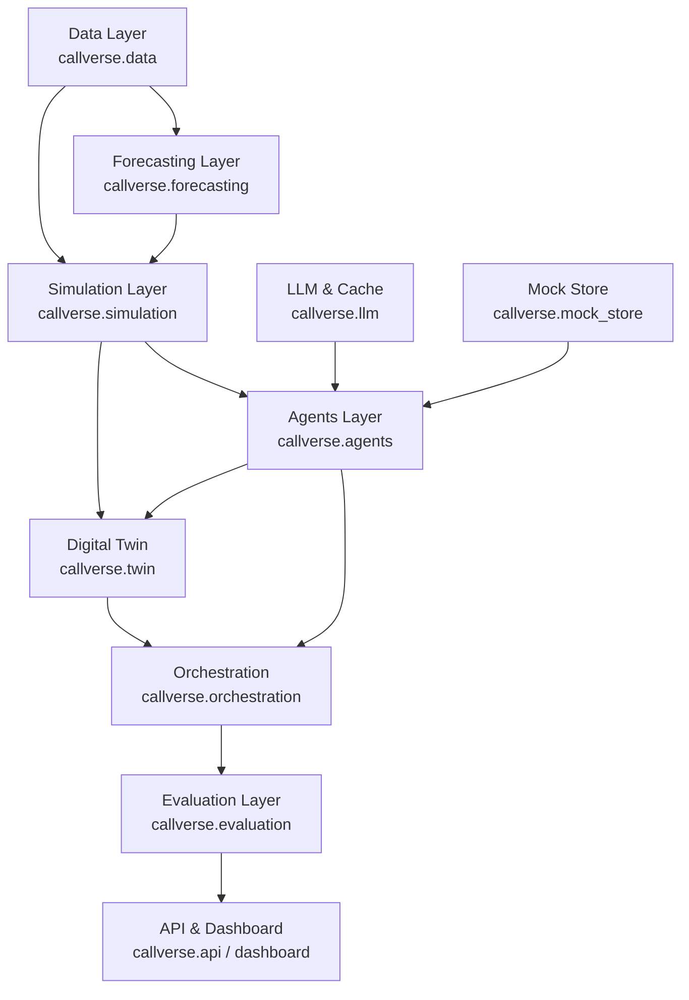

# CallVerse System Architecture

## Overview

CallVerse is a digital twin of an e-commerce customer-contact center operating across the complete contact lifecycle:
data generation, demand forecasting, discrete-event queueing simulation, agentic decision policies, closed-loop evaluation, and interactive operational interfaces.

## Architectural Layers

---

## Architectural Dependency Rules

The following import boundary rules are strictly enforced by `import-linter`:

1. **Data Layer Isolation (`callverse.data`)**:
   - Must **NOT** import from `agents`, `twin`, `orchestration`, `evaluation`, `api`, or `dashboard`.
   - Independent data schema, synthetic generator, preprocessing, and validation logic.

2. **Simulation Layer Isolation (`callverse.simulation`)**:
   - Must **NOT** import from `agents`, `twin`, `orchestration`, `evaluation`, `api`, or `dashboard`.
   - Self-contained discrete-event engine modeling queues, customers, servers, and policy protocols.

3. **Agents Layer Permitted Dependencies (`callverse.agents.*`)**:
   - May import from: `simulation`, `data`, `llm`, `mock_store`.
   - Must **NOT** import from: `twin`, `orchestration`, `evaluation`, `api`, `dashboard`.

4. **Digital Twin Layer Permitted Dependencies (`callverse.twin`)**:
   - May import from: `simulation`, `agents`, `llm`, `data`.
   - Must **NOT** import from: `orchestration`, `evaluation`, `api`, `dashboard`.

5. **Downstream Unrestricted Layers (`callverse.evaluation`, `callverse.api`, `callverse.dashboard`)**:
   - May import from any underlying layers as necessary for metrics aggregation, service routing, and visualization.

---

## Business Objectives to Data Science Objectives Mapping

| Business Objective | Data Science Objective (DSO) | Modules | KPI |
| :--- | :--- | :--- | :--- |
| **BO1: Service Level Agreement (SLA) & Wait Time Optimization** Ensure incoming customer contacts across chat/phone are routed with minimal delay and abandonment. | **DSO1: Multi-Horizon Arrival & Demand Forecasting** Produce calibrated contact volume and surge predictions across temporal slices and channels. | `callverse.forecasting` `callverse.simulation` | TBD |
| **BO2: Workforce Efficiency & Cost-to-Serve** Balance workforce staffing schedules, minimize idle cycles, and maximize agent multi-skill utilization. | **DSO2: Discrete-Event Queues & Workforce RL** Simulate queue dynamics and train reinforcement learning / heuristic policies for dynamic routing and shifts. | `callverse.simulation` `callverse.agents.workforce` | TBD |
| **BO3: First Contact Resolution (FCR) & Advisor Quality** Equip contact advisors with accurate retrieval-augmented responses and automated rubric scoring. | **DSO3: Local Knowledge Retrieval & Quality Review** Index policy documentation, retrieve contextual articles, and evaluate transcript compliance against rubrics. | `callverse.agents.advisor` `callverse.agents.quality` `callverse.mock_store` | TBD |
| **BO4: Customer Satisfaction & Churn Risk Mitigation** Model customer patience dynamics, sentiment trajectory, and evaluate system-wide counterfactual interventions. | **DSO4: Counterfactual Digital Twin & Replay Calibration** Calibrate simulation against historical traces and benchmark experimental policies in closed-loop twin. | `callverse.twin` `callverse.agents.client` `callverse.orchestration` `callverse.evaluation` | TBD |

---

## Assumptions

1. **Zero-Budget & Local Execution**: All components run locally with zero API cost. No network calls or paid external APIs are utilized; local stubbed/cached services and lightweight heuristics/models are employed.
2. **Python Environment**: Target runtime is Python 3.11+ using standard typed dataclasses, Protocols (`typing.Protocol`), and Pydantic schemas.
3. **Discrete-Event Simulation**: SimPy is the foundational engine for clock, event scheduling, agent desks, and queueing models.
4. **Reproducibility**: All stochastic components (generators, simulations, model initializers) ingest a deterministic random seed configurable via environment or parameters.
5. **Phase-0 Scope**: In Phase 0, no business logic is implemented. Only Protocols (`Policy`, `ServiceModel`), Typed Dataclasses (`State`, `Action`), and CLI skeleton are implemented to validate architecture and boundaries.
