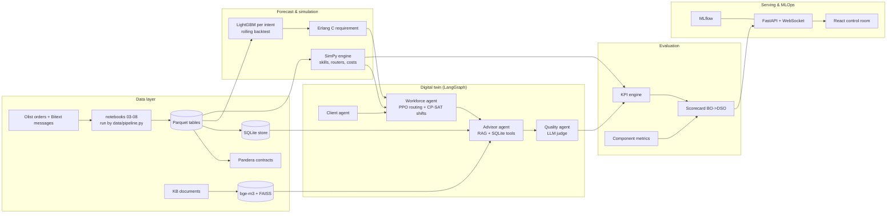

# CallVerse architecture

Five layers, each a package of `src/callverse/` and a page of the control room. A lower layer
never imports a higher one; the rule is enforced by `import-linter` (`pyproject.toml`).

| Package | Layer | Depends on |
|---|---|---|
| `config`, `llm`, `tracking` | infrastructure | — |
| `data` | data | infrastructure |
| `forecasting`, `simulation` | forecast & simulation | data |
| `agents` (client, advisor, quality, workforce) | agents | simulation, forecasting, data |
| `twin` | digital twin | agents, simulation, forecasting |
| `orchestration` | LangGraph | agents, twin |
| `evaluation` | evaluation | everything above |
| `api` | serving | everything |

Runtime split: PPO trains on the fast SimPy + Gymnasium environment (sampled intents, no LLM
calls); the LLM agents validate behaviour on a smaller set of conversations. Model versions are
pinned (`callverse llm-pin`), seeds are fixed in `configs/`.

The full description (models, formulations, results) is in
[IP_VALIDATION_REPORT.md](IP_VALIDATION_REPORT.md).
