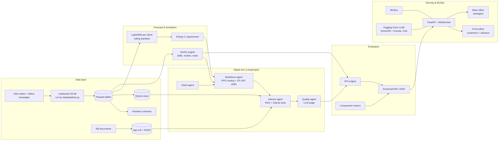

# CallVerse architecture

Five layers, each a package of `src/callverse/` and a section of the back office. A lower layer
never imports a higher one; the rule is enforced by `import-linter` (`pyproject.toml`).

| Package | Layer | Depends on |
|---|---|---|
| `config`, `llm`, `tracking` | infrastructure | — |
| `data` | data | infrastructure |
| `forecasting`, `simulation` | forecast & simulation | data |
| `agents` (client, advisor, quality, workforce) | agents | simulation, forecasting, data |
| `twin` | digital twin | agents, simulation, forecasting |
| `orchestration` | LangGraph | agents, twin |
| `evaluation` | evaluation | everything above |
| `api` | serving | everything |

Runtime split: PPO trains on the fast SimPy + Gymnasium environment (sampled intents, no LLM
calls); the LLM agents validate behaviour on a smaller set of conversations. Hugging Face model
commits are pinned (`callverse llm-pull` / `llm-pin`), seeds are fixed in `configs/`.

Two React apps share one API and one design system (`frontend/shared`):

| App | Users | Talks to |
|---|---|---|
| Front office (`frontend/front-office`) | customers, advisors | `/api/portal`, `/api/kb`, `/api/desk`, `/ws/session` (live chat, copilot, autopilot) |
| Back office (`frontend/back-office`) | managers | `/api/overview`, `/api/forecast`, `/api/twin/*` (incl. the live-floor replay), `/api/workforce`, `/api/agents`, `/api/quality`, `/api/evaluation`, `/api/mlops`, `/api/system` |

`/ws/session` drives `orchestration/live.py`: the same agents as the LangGraph run, one step at a
time, with a human on either side; tokens, tool calls and pipeline stages stream to the UI.

The full description (models, formulations, results) is in
[IP_VALIDATION_REPORT.md](IP_VALIDATION_REPORT.md).
